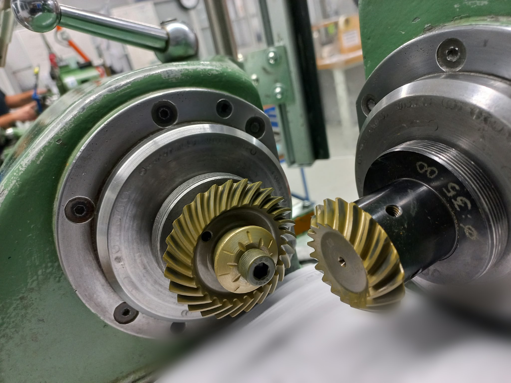

# Gear Lapping: More Than Noise

*October 17, 2026 · Mustapha*

Lapping is usually specified to make gears quieter, but its value goes well beyond noise. A lapped gear pair runs more smoothly, carries load more evenly, lasts longer, and has passed a final check that catches manufacturing deviations before they reach assembly. Quieter gears also mean less noise at the operator's workplace, which in Europe is a matter of law, not only comfort.

In short: **lapping is primarily an NVH-driven finishing process, but it equally serves functional performance, quality assurance and occupational health.**

## What lapping is

Lapping runs two mating gears together under light load with an abrasive paste between the flanks. Small high spots are worn away until the two tooth surfaces fit each other closely. Material removal is only a few micrometres.

It is used mainly on **spiral bevel and hypoid gears**, such as automotive axle drives, angle heads and tool holders, after heat treatment. On these gears, grinding is expensive or impractical, so lapping is the standard way to bring a hardened pair to its final running quality. Because the two gears are finished against each other, they leave the process as a **matched pair**.

*Photo: ESA Eppinger GmbH, 2024*

*A spiral bevel gear pair on a bevel gear lapping and test-rolling machine. The ring gear (left) and pinion (right) sit on two spindles whose axes meet at an angle; their positions are adjusted until the teeth mesh at the designed mounting distance and backlash. The golden coating on the flanks is the marking or lapping compound: after a run, the area where it has been worn away shows the contact pattern. The gears are nitrided to a surface hardness of about 700 HV, which is why final running quality is achieved by lapping rather than further cutting.*

## Noise: the primary reason

Gear noise is driven mainly by **transmission error**, the small deviation between the ideal and the actual motion of the driven gear, together with the varying stiffness of the teeth in mesh. Each tooth engagement produces a force pulse, so the noise appears as a tone at the **gear-mesh frequency** (number of teeth × shaft speed) and its harmonics. Listeners hear it as a whine.

Manufacturing tolerances, surface finish and tooth micro-geometry strongly influence this noise. Lapping smooths out small tooth-to-tooth errors and surface waviness, which lowers transmission error and the amplitude of the gear-mesh tone.

The noise is also largely **structure-borne**: vibration travels through the housing, bearings and mounts before it radiates as sound. A poorly finished gear pair therefore excites the whole assembly, not just the air around it.

## Function and durability

The same surface improvements that reduce noise also make the gear pair work better and last longer. Durability engineering asks "Will it break?"; NVH asks "How does it sound and feel?" Lapping answers both.

- **Better contact pattern:** the flanks are worn into each other, so load spreads over a larger, well-placed area instead of concentrating at edges or a single spot.
- **Smoother surface:** lower roughness reduces friction and heat at the contact and slightly improves efficiency.
- **Higher load capacity and longer life:** fewer stress peaks improve resistance to pitting, scuffing and micropitting.
- **Pre-run-in:** the pair behaves from the first hour as if it had already been run in, so early wear is reduced.
- **Correction of small heat-treatment distortion:** especially on hardened bevel and hypoid gears that are not ground.

## A quality gate before assembly

Lapping is also the last point where manufacturing deviations can be caught before they become someone else's problem. On the lapping or test-rolling machine, the pair runs under controlled conditions, and an abnormal contact pattern, noise or vibration reveals errors from cutting, heat treatment or runout.

- **Small deviations are corrected** by the lapping itself.
- **Larger deviations are detected and rejected** before the gears are shipped.

Without this step, deviations surface later and cost more: wrong backlash, difficult adjustment of the mounting distance during assembly, edge loading under torque, a clunk when the load reverses onto the coast flank, and finally early wear or failure in the transmission.

## The human side

Gear noise does not stay inside the machine; it reaches the people who work next to it. Gear whine is tonal and often lies between about 1 and 5 kHz, where human hearing is most sensitive and tonal sound is most annoying. This is why noise is measured in A-weighted decibels, dB(A), which weight frequencies the way the ear perceives them.

Long exposure causes **noise-induced hearing loss**, which is permanent. It also causes fatigue, reduced concentration and physiological stress, such as raised heart rate and blood pressure. Vibration transmitted to the hands or the whole body is a separate health risk, assessed for whole-body vibration under ISO 2631.

Every decibel removed at the source is therefore a direct contribution to a healthier workplace.

## Regulation: Europe sets the higher bar

In the EU, noise is regulated twice: once for the worker and once for the machine. There is no single regulating body; EU directives set the rules and each member state enforces them, in Germany through the Gewerbeaufsicht and the accident insurers (BG/DGUV). The US limits worker exposure too, but more leniently, and has no general duty to declare the noise a machine emits.

| Aspect | European Union | United States |
|---|---|---|
| Worker exposure (8 h average) | Directive 2003/10/EC: action values 80 and 85 dB(A), limit value 87 dB(A) | OSHA 29 CFR 1910.95: hearing conservation programme from 85 dB(A), permissible limit 90 dB(A) |
| Peak sound pressure | 135, 137 and 140 dB(C) for the three levels | 140 dB peak (OSHA guidance) |
| Exchange rate | 3 dB: every +3 dB halves the allowed time | 5 dB: every +5 dB halves the allowed time |
| Hearing protection | Counted only against the limit value, not the action values | Required above the action level |
| Machine noise emission | Machinery Directive 2006/42/EC (Regulation (EU) 2023/1230 from 20 January 2027): low-noise design required; emission declared above 70 dB(A) sound pressure and 80 dB(A) sound power | No general federal requirement to declare machine noise |
| National law | Germany: Lärm- und Vibrations-Arbeitsschutzverordnung | State OSHA plans may add requirements |

The exchange rate makes the gap large in practice. At a constant 95 dB(A), OSHA allows 4 hours. Under EU rules, the 85 dB(A) upper action value is reached after about 48 minutes and the 87 dB(A) limit after about 75 minutes. The US National Institute for Occupational Safety and Health (NIOSH) recommends 85 dB(A) with a 3 dB exchange rate, but this is not binding.

Sources: [Directive 2003/10/EC, Article 3](https://eur-lex.europa.eu/eli/dir/2003/10/oj) · [OSHA 29 CFR 1910.95](https://www.osha.gov/laws-regs/regulations/standardnumber/1910/1910.95)

## Where lapping reaches its limits

Lapping refines a good gear pair; it cannot rescue a bad one.

- **Large geometry errors stay.** Profile, lead and pitch errors beyond a few micrometres need grinding or honing.
- **Pairs must stay together.** Lapped gears are matched; replacing one gear loses the benefit.
- **Abrasive must be removed completely.** Residue left in the gearbox keeps wearing the flanks in service.
- **Too much lapping is harmful.** It can wear away intended flank modifications such as crowning and tip relief.

## Conclusion

Lapping is specified for noise, but it delivers far more. It reduces transmission error and gear whine, improves the contact pattern and load capacity, catches manufacturing deviations before they become assembly and transmission failures, and lowers the noise that operators are exposed to every day. In Europe, where worker exposure and machine emission are both regulated more strictly than in the US, that last point is also a compliance advantage.

The effect is measurable. A well-lapped pair shows lower gear-mesh amplitudes and fewer sidebands in a vibration spectrum, which is exactly what condition monitoring tracks over a gear's life. Manufacturing quality, machine health and human health turn out to be parts of the same story.
